# Saber Killer — Interaction & Inventory Architecture Audit

**Branch**: `feature/interaction-inventory-foundation`  
**Date**: November 23, 2026  
**Status**: Pre-Implementation Systems Audit

---

## 1. Existing System Analysis

### A. Player Controller & First-Person Camera (`js/multiplayer/player_controller.js`)
- **Camera Rig**: `THREE.PerspectiveCamera` (FOV 72, near 0.1, far 800) mounted to the player.
- **Orientation & Position**: Pitch and yaw tracking with mouse sensitivity ($0.0022$). World position tracked in `this.pos`.
- **Input Handling**: Pointer lock toggles mouse look. Keyboard captures WASD for movement, Digit1-3 for weapons, `KeyR` for reload.
- **Resource State**:
  - Health: `this.hp` ($100$), `this.maxHp` ($100$).
  - Stamina: `this.stamina` ($100$), `this.maxStamina` ($100$), sprinting drain ($25/\text{s}$), regen ($20/\text{s}$).
  - Battery: `this.battery` ($100$), `this.maxBattery` ($100$), flashlight drain ($1.67/\text{s}$).
  - Weapons & Ammo: `this.mag = { bullets: 12, shells: 6 }`, `this.bullets = 36`, `this.shells = 2`.
  - Sanity: Delegated to `SanityController` (`window.sanityController`), decoupled from local player class.
- **Interaction Hook**: `KeyE` is currently unmapped in `_onKeyDown`, providing a dedicated key for contextual interactions.

### B. World Item Manager (`js/multiplayer/item_manager.js`)
- **Structure**: Manages `this.items` array of item entries:
  ```javascript
  {
    id: placement.id,
    type: placement.type,
    name: definition.name,
    category: definition.category,
    object: THREE.Group (wrapper containing cloned GLTF mesh),
    anchor: placement.anchor,
    validation: { status, developerApproved, reason }
  }
  ```
- **Scene Graph Organization**: All item wrappers are children of `this.container` (`THREE.Group` named `WorldItemsContainer`). Each wrapper has `userData.id = placement.id`.
- **Target Identification**: Raycasting against `this.container.children` (recursive) hits mesh child nodes whose parent hierarchy leads to `wrapper.userData.id`.
- **Removal**: `removePlacement(id)` disposes geometries/materials and removes the wrapper from `this.container`. For multiplayer collection, a lightweight `hideItem(id)` / `removeItem(id)` is appropriate so items disappear instantly upon pickup.

### C. Server & Room Management (`server/room_manager.js` & `server/index.js`)
- **Room Lifecycle**: `RoomManager` manages rooms keyed by 4-character code (`roomCode`).
- **Layout Revision**: Each room locks to a frozen layout revision (`room.layoutRevision`), initialized on room creation from `world-layouts/level0/latest.json` or fallback `assets/data/world_items.json`.
- **Missing Server State (To Implement)**:
  1. *Player Position Tracking*: Server currently forwards `PLAYER_UPDATE` without caching position. The server must cache `player.position = { x, y, z }` from validated updates to perform proximity checks.
  2. *Room-Level Pickup State*: Server must maintain `room.worldItems = new Map()` containing item availability, coordinates, and collector ID.
  3. *Player Inventories*: Server must store authoritative per-player inventories (`player.inventory = []`) and validate slot stacking.

### D. Visual Asset & HUD Style (`assets/ui/icons/`)
- **Existing SVG Assets**:
  - `hud_ammo.svg` (MDI Ammunition)
  - `hud_battery.svg` (Material Two-Tone Battery)
  - `hud_brain.svg` (MDI Brain)
  - `hud_health.svg` (Material Two-Tone Favorite)
  - `hud_stamina.svg` (Material Two-Tone Directions Run)
  - `hud_pause.svg` (Material Two-Tone Pause Circle)
- **Visual Design Rules**:
  - `viewBox="0 0 24 24"`, default dimensions 48x48.
  - Base monochromatic off-white `#edece6` (`rgba(237, 236, 230)`).
  - Two-tone depth: secondary translucent fill at `0.35` opacity with solid structural outlines.
  - Alpha-transparent backgrounds with zero opaque square backing plates.

---

## 2. Integration Architecture Plan

```mermaid
sequenceDiagram
    autonumber
    actor Player as Player (Client A)
    participant IM as InteractionManager
    participant IC as InventoryController
    participant NC as NetworkClient
    participant Server as Game Server
    participant Peer as Peer (Client B)

    Note over Player,IM: Player looks at First Aid Box (within 2.1m)
    IM->>IM: Camera raycast hits item wrapper
    IM->>Player: Display "[E] Take First Aid Kit" hint
    Player->>IM: Press KeyE (single event)
    IM->>NC: send('ITEM_PICKUP_REQUEST', { itemId: 'shelf_first_aid_tier4' })
    NC->>Server: ITEM_PICKUP_REQUEST
    
    rect rgb(20, 30, 45)
        Note over Server: Authoritative Validation
        Server->>Server: 1. Verify player & room
        Server->>Server: 2. Check item exists in frozen room layout
        Server->>Server: 3. Verify item is available
        Server->>Server: 4. Check distance (server player pos vs item pos <= 2.1m)
        Server->>Server: 5. Atomically claim item (available = false)
        Server->>Server: 6. Add item to player.inventory
    end

    Server-->>Peer: Broadcast ITEM_COLLECTED { itemId, playerId }
    Peer->>Peer: Hide world item from scene
    Server-->>NC: Broadcast ITEM_COLLECTED { itemId, playerId }
    NC->>IM: Hide world item from scene
    Server-->>NC: send('INVENTORY_UPDATE', { inventory })
    NC->>IC: updateFromNetwork(inventory)
    IC->>Player: Inventory updated (item added to slot)
```



---

## 3. Strict Scope Adherence
- **In Scope**:
  - Camera-centered raycasting at $2.1\text{m}$.
  - Target tracking, hover/unhover, HUD prompt.
  - `KeyE` single-trigger interaction.
  - Central data-driven item catalog.
  - Cohesive SVG icon extensions matching HUD.
  - Inventory data controller with stacking and serialization.
  - Server-authoritative pickup validation & proximity check.
  - Multi-client synchronization and frozen room layout persistence.
  - Developer inventory inspector panel.
- **Out of Scope (Deferred)**:
  - Final inventory grid UI.
  - Right-click context menus.
  - Consumable gameplay effects (health/sanity restores).
  - Physical dropped-item spawning.
  - Weapon reserve modifications.
  - Audio sound effects.
  - Single-player Story Mode files (remain 100% untouched).
